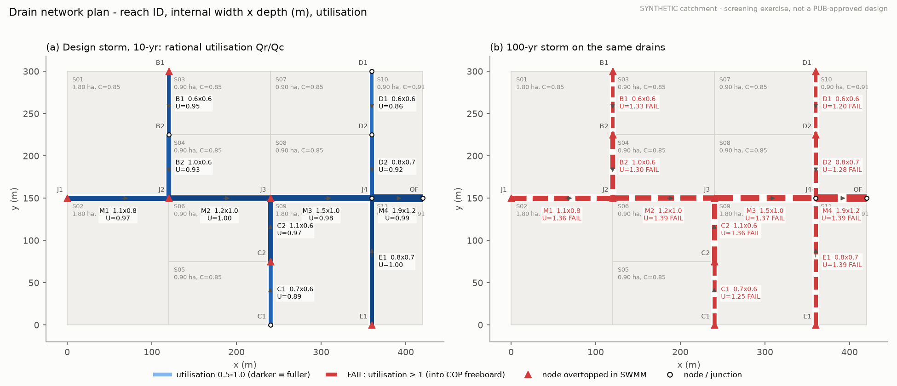
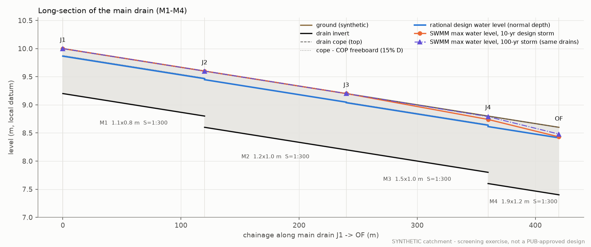
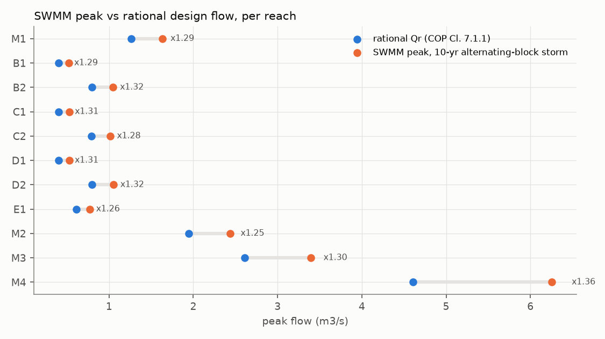
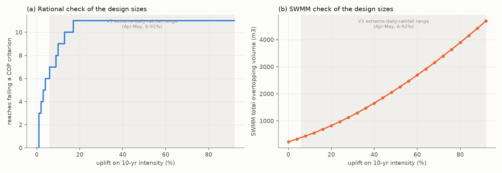

# sg-drainage-swmm

**Screening-level surface-water drain design and check, following PUB's Code of Practice on Surface Water Drainage, on a SYNTHETIC catchment.**

> **Read this first.** This is a personal learning project. The catchment, levels and land use are invented. It is not a PUB-approved design, not a submission, and not professional engineering advice. Drain design in Singapore is done and endorsed by a Qualified Person / Professional Engineer under the COP and PUB's requirements. The COP itself is not redistributed here: it is referenced (see [docs/sources.md](docs/sources.md)).

<!-- README.md is generated from docs/README.template.md by scripts/run_all.py. Do not edit README.md by hand. -->

## What it does

1. **Catchment.** A 12.6 ha synthetic residential estate: 11 sub-catchments, 11 open U-drain reaches (1020 m) along a road grid, one free outfall. Runoff coefficients are area-weighted from the COP land-use classes (C = 0.64 to 0.91).
2. **Rational-method design** per COP Clause 7: Qr = C I A / 360, IDF from COP Appendix 4 (digitised, see below), 10-year return period (Clause 7.1.3, catchment under 100 ha), tc = overland time + drain flow time iterated to a fixed point, and the smallest rectangular concrete section that meets Manning capacity with 15% freeboard, 1.0 to 3.0 m/s and Froude number at most 0.8.
3. **Hydraulic check in EPA SWMM 5.2** (official engine via `swmm-toolkit`): the same network, dynamic-wave routing, a 120-minute alternating-block design storm built from the same IDF curve.
4. **Stress test:** the design sizes under a climate uplift (both ends of the range published for Singapore's Third National Climate Change Study) and under the 100-year storm; which reaches fail, the minimum upsizing that restores COP compliance, and what SWMM says about it.
5. **Drawing-like outputs:** a plan with reach IDs and utilisation colours, and a long-section of the main drain.

## Headline numbers

All values below are generated from files in [`results/`](results/) by `scripts/run_all.py`.

| | |
|---|---|
| Design storm | 10-year, IDF from COP Appendix 4; alternating-block hyetograph, 5-min blocks, 113.8 mm in 120 min, peak block 215.6 mm/hr |
| Reaches designed | 11, all meeting the COP checks used: yes; tc iteration converged for all: yes (at most 4 iterations) |
| Max capacity utilisation (Qr / capacity at 0.85 D) | 0.997 (reach E1); range 0.856 to 0.997 |
| Outfall design flow | 4.606 m3/s at tc = 18.6 min, I = 161.8 mm/hr, section 1.9 m x 1.2 m |
| SWMM peak / rational Qr | 1.25 to 1.36 across the reaches (outfall 6.253 vs 4.606 m3/s) |
| SWMM, design storm, design sizes | overtopping at 6 nodes, 230 m3 in total; water enters the COP freeboard in 11 of 11 reaches |
| SWMM continuity error | design run: runoff -0.027%, routing -0.127%; largest magnitude over all 183 SWMM runs: 0.163% (test threshold 1%) |
| Headroom of the design sizes | the first reach breaks a COP criterion at +1% intensity, the last at +17% |
| 100-year storm | 11 of 11 reaches fail (max utilisation 1.39); SWMM overtopping 1647 m3; minimum rational upsizing: 11 reaches, +28% drain volume |
| 10-year +92% (bounding climate case) | 11 of 11 reaches fail (max utilisation 1.92); SWMM overtopping 4690 m3; minimum rational upsizing: +62.9% drain volume |

The main finding is the gap between the two methods, not the drain sizes. The COP rational method gives the smallest compliant sections. Under its own design storm, SWMM shows those sections running full and overtopping at a few nodes. That gap comes from assumptions the COP leaves open, explained in [SWMM check](#swmm-check).

## How to run

Python 3.11. Everything installs into a local `.venv`.

```bash
python -m venv .venv
. .venv/bin/activate            # Windows: .venv\Scripts\activate
pip install -r requirements.txt
python scripts/run_all.py       # design, SWMM, stress test, figures, README
pytest                          # tests (offline)
python mutation/run_mutants.py  # optional: mutation test of the test suite
```

`scripts/run_all.py` rewrites everything under `results/` and regenerates this README from `docs/README.template.md`. SWMM runs in a temporary directory, so `.rpt` and `.out` files never land in the repo. The `.inp` models are kept in `results/models/` and open in the EPA SWMM GUI.

The IDF table in `data/` was produced by `tools/digitize_idf.py` from a locally downloaded copy of the COP PDF (`pip install -r requirements-tools.txt`; the script checks the PDF's SHA-256). The pipeline and tests only read the committed CSV.

## Design table (rational method, 10-year)

| Reach | Nodes | L (m) | Slope | A (ha) | C | tc (min) | I (mm/hr) | Qr (m3/s) | W x D (m) | y/D | V (m/s) | Fr | Util. | COP checks |
|---|---|---|---|---|---|---|---|---|---|---|---|---|---|---|
| M1 | J1->J2 | 120 | 1:300 | 3.60 | 0.746 | 16.2 | 169.6 | 1.266 | 1.1 x 0.8 | 0.83 | 1.73 | 0.68 | 0.97 | yes |
| B1 | B1->B2 | 75 | 1:250 | 0.90 | 0.853 | 10.9 | 189.1 | 0.403 | 0.6 x 0.6 | 0.82 | 1.37 | 0.63 | 0.95 | yes |
| B2 | B2->J2 | 75 | 1:250 | 1.80 | 0.853 | 11.7 | 186.4 | 0.795 | 1.0 x 0.6 | 0.80 | 1.65 | 0.76 | 0.93 | yes |
| C1 | C1->C2 | 75 | 1:341 | 0.90 | 0.853 | 11.0 | 188.7 | 0.402 | 0.7 x 0.6 | 0.78 | 1.23 | 0.58 | 0.89 | yes |
| C2 | C2->J3 | 75 | 1:357 | 1.80 | 0.853 | 11.9 | 185.7 | 0.792 | 1.1 x 0.6 | 0.83 | 1.44 | 0.65 | 0.97 | yes |
| D1 | D1->D2 | 75 | 1:203 | 0.90 | 0.853 | 10.8 | 189.4 | 0.404 | 0.6 x 0.6 | 0.75 | 1.49 | 0.71 | 0.86 | yes |
| D2 | D2->J4 | 75 | 1:197 | 1.80 | 0.853 | 11.5 | 186.9 | 0.797 | 0.8 x 0.7 | 0.79 | 1.79 | 0.77 | 0.92 | yes |
| E1 | E1->J4 | 150 | 1:395 | 1.80 | 0.735 | 16.9 | 167.0 | 0.614 | 0.8 x 0.7 | 0.85 | 1.29 | 0.54 | 1.00 | yes |
| M2 | J2->J3 | 120 | 1:300 | 5.40 | 0.782 | 17.2 | 166.1 | 1.947 | 1.2 x 1.0 | 0.85 | 1.92 | 0.66 | 1.00 | yes |
| M3 | J3->J4 | 120 | 1:300 | 7.20 | 0.799 | 18.2 | 163.1 | 2.607 | 1.5 x 1.0 | 0.84 | 2.07 | 0.72 | 0.98 | yes |
| M4 | J4->OF | 60 | 1:300 | 12.60 | 0.813 | 18.6 | 161.8 | 4.606 | 1.9 x 1.2 | 0.84 | 2.39 | 0.76 | 0.99 | yes |

`Util.` = Qr / Qc, where Qc is Manning capacity with the water surface at 0.85 D, i.e. keeping the COP freeboard. Sub-catchment runoff enters at the upstream node of the reach it drains to. All invert gradients follow the ground (gradient changes needed: 0). Full columns, including the convergence residual of the tc iteration, are in [`results/design_table.csv`](results/design_table.csv). Invert and cope levels are in [`results/design_levels.csv`](results/design_levels.csv).





Design sensitivity ([`results/sensitivity_design.json`](results/sensitivity_design.json)):

- Overland time is the COP's widest open choice (Clause 7.1.4 allows 5 to 15 min). Setting it to the bottom of that range for every sub-catchment raises the outfall flow by 20.8% and changes 9 of 11 sections. Setting it to the top of the range changes the outfall flow by -1% and changes 5 sections.
- The IDF digitisation has a one-pixel reading resolution of about 0.51% in intensity. Shifting all intensities by minus or plus one percent changes 1 and 3 sections respectively.

## SWMM check

| Reach | Rational Qr (m3/s) | SWMM peak (m3/s) | SWMM / rational | Rational y/D | SWMM max y/D | SWMM max V (m/s) |
|---|---|---|---|---|---|---|
| M1 | 1.266 | 1.630 | 1.29 | 0.83 | 1.00 | 1.88 |
| B1 | 0.403 | 0.520 | 1.29 | 0.81 | 1.00 | 1.45 |
| B2 | 0.795 | 1.048 | 1.32 | 0.80 | 1.00 | 1.76 |
| C1 | 0.402 | 0.528 | 1.31 | 0.78 | 0.99 | 1.27 |
| C2 | 0.792 | 1.013 | 1.28 | 0.83 | 1.00 | 1.58 |
| D1 | 0.404 | 0.527 | 1.31 | 0.75 | 0.95 | 1.54 |
| D2 | 0.797 | 1.052 | 1.32 | 0.79 | 0.94 | 2.01 |
| E1 | 0.614 | 0.773 | 1.26 | 0.85 | 0.95 | 1.56 |
| M2 | 1.948 | 2.438 | 1.25 | 0.85 | 1.00 | 2.06 |
| M3 | 2.607 | 3.393 | 1.30 | 0.84 | 0.97 | 2.45 |
| M4 | 4.606 | 6.253 | 1.36 | 0.84 | 0.90 | 3.04 |

SWMM peaks are higher than the rational Qr in every reach (ratio 1.25 to 1.36). The difference is expected, and most of it can be traced at sub-catchment level ([`results/subcatchment_swmm_vs_rational.csv`](results/subcatchment_swmm_vs_rational.csv)):

| Sub-catchment | Land use | COP C | to (min) | Rational Q (m3/s) | SWMM peak (m3/s) | Ratio | Duration factor | Runoff factor |
|---|---|---|---|---|---|---|---|---|
| S01 | residential | 0.85 | 10 | 0.821 | 1.060 | 1.29 | 1.12 | 1.15 |
| S02 | residential_park | 0.64 | 15 | 0.556 | 0.870 | 1.56 | 1.24 | 1.26 |
| S03 | residential | 0.85 | 10 | 0.411 | 0.530 | 1.29 | 1.12 | 1.15 |
| S04 | residential | 0.85 | 10 | 0.411 | 0.530 | 1.29 | 1.12 | 1.15 |
| S05 | residential | 0.85 | 10 | 0.411 | 0.530 | 1.29 | 1.12 | 1.15 |
| S06 | residential | 0.85 | 10 | 0.411 | 0.530 | 1.29 | 1.12 | 1.15 |
| S07 | residential | 0.85 | 10 | 0.411 | 0.530 | 1.29 | 1.12 | 1.15 |
| S08 | residential | 0.85 | 10 | 0.411 | 0.530 | 1.29 | 1.12 | 1.15 |
| S09 | school | 0.73 | 15 | 0.639 | 0.970 | 1.52 | 1.24 | 1.22 |
| S10 | commercial | 0.91 | 5 | 0.489 | 0.540 | 1.10 | 1.00 | 1.10 |
| S11 | commercial | 0.91 | 5 | 0.489 | 0.540 | 1.10 | 1.00 | 1.10 |

- **Duration factor** = peak 5-minute block intensity / IDF intensity at the overland time used in the rational method. The rational method applies the intensity for a duration equal to tc, with a 5 to 15 min overland time. SWMM's surface runoff from short, smooth paved areas responds within minutes, so it picks up the 5-minute peak that the alternating-block storm contains. Range: 1.00 to 1.24.
- **Runoff factor** = (SWMM peak runoff / peak rainfall rate on the area) / COP C. SWMM's losses (depression storage plus Green-Ampt infiltration in a clay-loam soil) remove less water at the peak than the COP coefficients imply. Range: 1.10 to 1.26. Event runoff coefficients in SWMM are 0.893 to 0.977, against COP C of 0.64 to 0.91.
- In the network, routing through the drains attenuates and offsets the sub-catchment peaks, which fits the reach ratios lying between the sub-catchment extremes. Where a drain runs full, SWMM also caps the flow: `SWMM max y/D` reaches the full drain depth, and the excess overtops at the upstream node.
- SWMM's peak velocity also exceeds the COP's 3.0 m/s limit in reach(es) M4. The rational check at normal depth does not show this.
- A sandier soil (sandy loam, SWMM manual Table A.2) lowers the event runoff coefficient to 0.864 but barely moves the outfall peak (6.217 m3/s). Overtopping falls to 109 m3. Losses matter less than timing for these peaks.

**SWMM-led upsizing (heuristic).** Repeatedly enlarging the most downstream failing reaches by one catalogue step, until SWMM shows no overtopping and no reach deeper than 0.85 D, takes 11 reaches and +28.7% drain volume for the design storm. The heuristic only targets depth: its final peak velocity is 3.00 m/s against the COP limit of 3.0 m/s. It is not proven minimal.



Continuity: runoff -0.027% and flow routing -0.127% for the design run. Across all 183 SWMM runs the largest magnitude is 0.163% ([`results/swmm_run_log.json`](results/swmm_run_log.json)). The tests require below 1%.

## Stress test

Uplifts are applied multiplicatively to the 10-year IDF intensities. The +6% and +92% values are the two ends of the range the V3 news release gives for extreme *daily* rainfall in April and May. Applying a daily-rainfall change to short-duration intensities is this project's assumption. The upper end is treated as a bounding case, not a projection for design. The 100-year case uses the COP's own 100-year curve.

| Scenario | Max utilisation (design sizes) | Reaches failing (rational) | SWMM overtopping (design sizes) | Minimum rational upsizing | SWMM overtopping after rational upsizing | SWMM-led greedy upsizing |
|---|---|---|---|---|---|---|
| 10-yr storm +6% (low end of V3 range) | 1.06 | 7 / 11 | 9 nodes, 387 m3 | 7 reaches, +6.9% | 150 m3 | 11 reaches, +34.2% |
| 10-yr storm +92% (high end of V3 range, bounding) | 1.92 | 11 / 11 | 11 nodes, 4690 m3 | 11 reaches, +62.9% | 450 m3 | 11 reaches, +112.0% |
| 100-yr storm, COP Appendix 4 curve | 1.39 | 11 / 11 | 10 nodes, 1647 m3 | 11 reaches, +28.0% | 368 m3 | 11 reaches, +67.1% |

"Minimum rational upsizing" keeps each reach's gradient and never shrinks a section. It picks the smallest catalogue section that passes every COP check again, and is minimal within the catalogue by construction. Because SWMM peaks run above rational Qr, those sections still overtop in SWMM. The SWMM-led column shows the larger enlargement the dynamic check asks for.

| Reach | Design W x D (m) | Rational upsizing: 10-yr storm +6% (low end of V3 range) | Rational upsizing: 10-yr storm +92% (high end of V3 range, bounding) | Rational upsizing: 100-yr storm, COP Appendix 4 curve |
|---|---|---|---|---|
| M1 | 1.1 x 0.8 | 1.2 x 0.8 | 1.3 x 1.1 | 1.4 x 0.8 |
| B1 | 0.6 x 0.6 | 0.7 x 0.6 | 1.0 x 0.6 | 0.8 x 0.6 |
| B2 | 1.0 x 0.6 | - | 1.2 x 0.8 | 1.1 x 0.7 |
| C1 | 0.7 x 0.6 | - | 0.9 x 0.7 | 0.9 x 0.6 |
| C2 | 1.1 x 0.6 | 1.2 x 0.6 | 1.8 x 0.6 | 1.4 x 0.6 |
| D1 | 0.6 x 0.6 | - | 0.8 x 0.7 | 0.7 x 0.6 |
| D2 | 0.8 x 0.7 | - | 1.0 x 0.9 | 0.9 x 0.8 |
| E1 | 0.8 x 0.7 | 0.9 x 0.7 | 1.3 x 0.7 | 0.9 x 0.8 |
| M2 | 1.2 x 1.0 | 1.3 x 1.0 | 1.8 x 1.1 | 1.4 x 1.1 |
| M3 | 1.5 x 1.0 | 1.6 x 1.0 | 1.9 x 1.3 | 1.6 x 1.2 |
| M4 | 1.9 x 1.2 | 2.0 x 1.2 | 2.2 x 1.7 | 2.1 x 1.4 |

Uplift sweep with the design sizes, in 1% steps for the rational check and 4% steps in SWMM ([`results/uplift_sweep_rational.csv`](results/uplift_sweep_rational.csv), [`results/uplift_sweep_swmm.csv`](results/uplift_sweep_swmm.csv)):

| Reach | Smallest uplift that breaks a COP criterion |
|---|---|
| M1 | +3% |
| B1 | +6% |
| B2 | +9% |
| C1 | +13% |
| C2 | +4% |
| D1 | +17% |
| D2 | +10% |
| E1 | +1% |
| M2 | +1% |
| M3 | +2% |
| M4 | +1% |



The design sizes have almost no headroom. Smallest-compliant sizing plus a 0.1 m size grid leaves utilisations of 0.856 to 0.997, so any uplift breaks some reach. A real design would choose standard sections, usually with margin.

## Method

- **Rational formula** (COP Cl. 7.1.1): Qr = C I A / 360 (m3/s, mm/hr, ha). C is weighted by area from the Cl. 7.1.2 classes: roads/paved 1.00, urban 0.90, vegetated/pervious 0.45.
- **Return period** (Cl. 7.1.3): 10 years for a catchment under 100 ha.
- **IDF**: the COP gives the IDF relationship only as a chart (Appendix 4). `tools/digitize_idf.py` reads the embedded chart image, calibrates both log axes from the detected grid lines, and traces all eight return-period curves. It tabulates 27 durations from 5 to 600 min. Reading resolution is about 0.51% per pixel, and the largest local-fit residual is 1.33 px. Between tabulated durations, values are interpolated linearly on log-log axes.
- **Time of concentration** (Cl. 7.1.4): tc = to + td. The overland time to is taken per land use within the COP's 5 to 15 min range (5, 10, 15 min). The drain time td comes from the Manning velocity in the chosen section. Because the section depends on Qr, which depends on tc, each reach is iterated to a fixed point (tolerance in `sgdrain/rational.py`).
- **Sizing** (Cl. 7.2.2, 7.2.3, 7.3.1 to 7.3.4, 4.3.1): rectangular open concrete drain, n = 0.015, steady uniform flow at normal depth. A section is accepted if y is at most 0.85 D, V is between 1.0 and 3.0 m/s, and Fr is at most 0.8. Width and depth must each be at least 600 mm, and sections come from a 0.1 m catalogue (0.6 to 3 m wide, 0.6 to 2 m deep). The smallest area wins. The invert follows the ground slope; a list of alternative gradients is tried only if no section fits.
- **Levels**: the drain cope is at or below ground at both ends, and no drain starts above the inverts of the drains flowing into it.
- **Hyetograph**: alternating block (Chow, Maidment & Mays, *Applied Hydrology*, 1988, ch. 14), 5-min blocks over 120 min with the peak in the centre. The central window of k blocks holds the k largest IDF depth increments. The storm therefore reaches at least the IDF depth for every duration up to its length, and exactly that depth where the digitised depth-duration curve is concave. A test checks this.
- **SWMM**: SWMM 5.2 through `swmm-toolkit`, dynamic wave, 1 s routing step. Conduits are open rectangular, invert elevations come from the design, and the outfall is free. Node overflow level is the highest drain cope at the node, with no ponding: water above it is reported as overtopping (flooding) and lost. Sub-catchment parameters are in [Assumptions](#assumptions).

## Assumptions

- **Synthetic catchment**: geometry, ground levels (arbitrary local datum, not SHD), land-use split and overland times are invented to look plausible. No public elevation data was used.
- **Lumped inflow**: each sub-catchment discharges at the upstream node of its reach. This is conservative for the rational method and identical in SWMM.
- **Minimum size**: COP Cl. 4.3.1 sets the 600 mm minimum for roadside drains in a *closed* drainage system. It is applied here to every drain.
- **Size catalogue and gradient list**: illustrative. Real roadside drains follow the LTA standard details referenced in COP Cl. 9.1.2 / Drawing No. 1, which were not used.
- **SWMM hydrology** (sources in [docs/sources.md](docs/sources.md)): percent impervious = roads 100%, urban plots 90%, vegetated 0%. Overland flow length is 30 to 60 m depending on land use, and width = area / length. N-imperv 0.011, N-perv 0.15 (SWMM manual Table A.6). Depression storage 1.27 / 2.54 mm (lower end of Table A.5). %Zero-Imperv 25. Green-Ampt clay loam from Table A.2: suction 210.1 mm, Ksat 1.016 mm/hr, initial deficit 0.154. None of this is calibrated.
- **Climate uplift**: one multiplier on every duration, taken from the range given for extreme *daily* rainfall (see Stress test).

## Limitations

- Screening only: no structural, geotechnical, utility, maintenance-access or construction checks. No sumps, transitions or bends (COP Cl. 9), no dry-weather-flow channel detail (Cl. 7.3.1, Drawing No. 1), no culverts. Outfall tailwater and tidal or canal levels are ignored (free outfall).
- Cl. 7.1.5 (maximum allowable peak runoff from larger development sites, usually met with on-site detention) is outside this exercise.
- The IDF values are a digitisation of a scanned chart, not PUB tabulated data.
- The rational method's checks are at normal depth. Backwater only appears in SWMM.
- SWMM overland-flow and loss parameters are textbook values, not calibrated to any Singapore catchment. The SWMM/rational gap depends on them and on the choice of an alternating-block storm, which nests every duration's peak in one event.
- The SWMM-led upsizing is a greedy heuristic and only looks at depth and overtopping.

## Repository layout

```
data/        synthetic catchment definition, digitised IDF table and its metadata
sgdrain/     COP constants (cop.py), Manning (hydraulics.py), IDF, hyetograph,
             rational design/check/upsize, SWMM writer/runner, pipeline, plots, README renderer
scripts/     run_all.py - regenerates results/ and README.md
results/     every number quoted above (CSV/JSON), figures, SWMM .inp models
tools/       digitize_idf.py - IDF chart digitiser (needs a local copy of the COP PDF)
tests/       pytest suite (offline)
mutation/    mutation testing of the test suite and its report
docs/        README template and sources with clause references
```

## Tests

`pytest` runs 57 tests offline. They cover:

- Manning and continuity invariants: capacity monotonic in width, depth and slope, Q = V A, and normal depth as the inverse of Manning.
- Rational-method arithmetic.
- Weighted C and the COP return-period rule.
- tc convergence, with each residual re-checked independently.
- Smallest-section optimality and COP criteria on every reach.
- The alternating-block window property.
- SWMM continuity below 1%, and a re-run of the SWMM design model checked against the committed results.
- Upsizing never shrinks a section and restores compliance.
- README numbers checked against `results/`.

**Mutation test of the tests** ([`mutation/run_mutants.py`](mutation/run_mutants.py), report in [`results/mutation_report.json`](results/mutation_report.json)). The script plants 20 deliberate bugs, one at a time, in a scratch copy of the repo. It first checks that the unmodified suite passes and that every mutant compiles. In the first round the suite killed 18 of 20 mutants. The survivors were M13 (minimum self-cleansing velocity not checked), M15 (drain may start above the inverts flowing into it). The second survived because that level constraint never binds in this network. Tests were then added that check each section criterion flag on its own and force the level constraint to bind. In the latest round (round 2, 57 tests) the suite killed **20 of 20**. Survivors: none.

## Sources

Full list with URLs, retrieval dates and clause/table/page references: [docs/sources.md](docs/sources.md). In short:

- PUB, *Code of Practice on Surface Water Drainage*, Seventh Edition (Dec 2018) with amendments under Addendum No. 3 (April 2025). Clauses 4.3.1, 7.1.1 to 7.1.4, 7.2.2, 7.2.3, 7.3.1 to 7.3.4 and Appendix 4.
- US EPA, *Storm Water Management Model User's Manual Version 5.2* (EPA/600/R-22/030, 2022): Tables A.2, A.5 and A.6.
- MSS/MSE joint news release on Singapore's Third National Climate Change Study (V3), 5 January 2024: the range for extreme daily rainfall.
- Chow, Maidment & Mays (1988), *Applied Hydrology*, McGraw-Hill: alternating block method.

## Licence

MIT (code and generated results). The PUB COP and the EPA manual are third-party documents and are only referenced.
